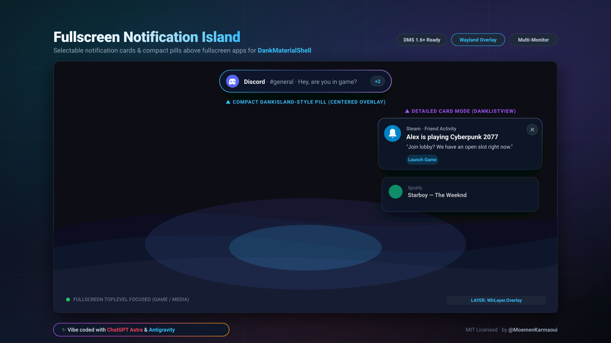
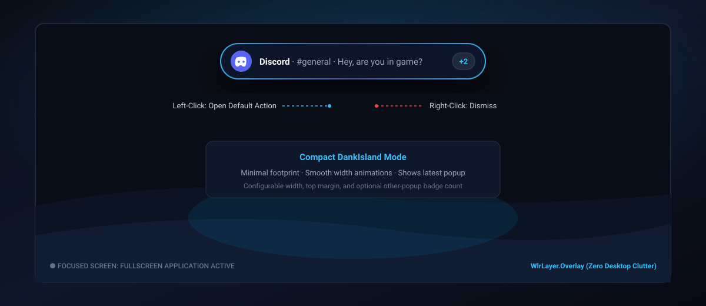
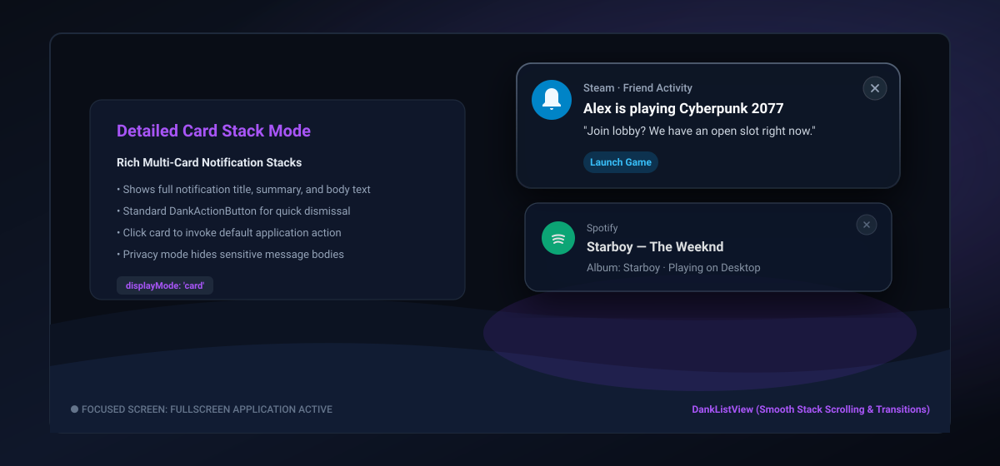

# Fullscreen Notification Island

[](https://github.com/MoemenKarmaoui/fullscreen-notification-island)
[](LICENSE)
[](https://github.com/AvengeMedia/dms)
[](https://wayland.freedesktop.org/)



> ✨ **Notice:** This whole plugin was proudly **vibe coded** from start to finish with **ChatGPT Astra** and **Antigravity**!

---

## 📖 Overview

**Fullscreen Notification Island** is a daemon plugin for [DankMaterialShell (DMS)](https://github.com/AvengeMedia/dms) that displays non-intrusive notifications directly above fullscreen games, videos, and applications without disrupting your workflow or desktop environment.

### 🌟 Why this plugin?
In standard DMS configurations, notifications and docks reside on the `top` layer-shell layer so they stay tucked away behind fullscreen windows. When you want to see incoming alerts while gaming or watching videos in fullscreen:
- **Zero Desktop Clutter:** Unlike global overlay switches, this plugin does *not* force your entire bar, dock, or notification center on top of fullscreen apps.
- **Smart Temporary Surface:** It summons a tiny, click-through `WlrLayer.Overlay` surface on the focused monitor **only while an active notification exists** and immediately hides it once dismissed or timed out.
- **DMS Native Harmony:** Completely adheres to DMS's built-in popup timeouts, notification grouping, urgency policies, Do-Not-Disturb (DND), and queue manager.
- **Reactive & Lightweight:** 100% event-driven via Quickshell/Wayland signals. No background polling loops, no wasted CPU cycles.

---

## 🎨 Notification Styles & Modes

You can switch between two distinct presentation styles anytime from **DMS Settings → Plugins**:

### 1. 🏝️ Compact DankIsland Mode (`displayMode: "island"`)
A centered, pill-shaped notification overlay inspired by Dynamic Island / DankIsland. Shows the originating application, title preview, and an optional `+N` badge counter for concurrent alerts.



* **Best for:** Gaming and movie watching where you want minimal distraction.
* **Features:** Smooth width expansion, centered top alignment, and active notification count badge.

---

### 2. 🗂️ Detailed Card Stack Mode (`displayMode: "card"`)
A rich, stacked notification card interface powered by `DankListView` and styled with Material 3 tokens.



* **Best for:** Workstations and communication where reading message bodies and seeing app icons matters.
* **Features:** Supports multi-card stacks (up to 4 cards), full message body text, interactive action chips, and a native `DankActionButton` dismiss button.
* **Privacy Mode Support:** Automatically hides sensitive body text if `SettingsData.notificationPopupPrivacyMode` is enabled in DMS.

---

## 🖱️ User Controls & Gestures

Both styles support intuitive mouse interactions:

| Action | Gesture | Behavior |
| :--- | :--- | :--- |
| **Open App / Action** | **Left-Click** on card/pill | Invokes the notification's standard `default` action (e.g. open message in Discord, launch game in Steam). If no default action exists, safely hides the temporary popup. |
| **Dismiss Popup** | **Right-Click** anywhere on popup | Dismisses the notification immediately. |
| **Close Button** | Click **✖** (`DankActionButton`) | Dismisses the card (*Card Mode only*). |
| **Resident Alerts** | Automatic | Resident notifications (like music players) remain available in your DMS Notification Center after the temporary overlay is dismissed. |

---

## 🚀 Installation Guide

### Option A: Direct Git Clone (Recommended)
Clone the repository directly into your local DMS plugins directory:

```bash
# 1. Create plugins directory if it doesn't exist
mkdir -p ~/.config/DankMaterialShell/plugins

# 2. Clone the repository as 'FullscreenNotificationIsland'
git clone https://github.com/MoemenKarmaoui/fullscreen-notification-island.git ~/.config/DankMaterialShell/plugins/FullscreenNotificationIsland

# 3. Tell DMS to scan for new plugins
dms ipc call plugin-scan scan
```

---

### Option B: Manual Zip Download
1. Download or download repository ZIP from GitHub.
2. Unzip into `~/.config/DankMaterialShell/plugins/`:
   ```bash
   unzip -o fullscreen-notification-island-main.zip -d ~/.config/DankMaterialShell/plugins/
   mv ~/.config/DankMaterialShell/plugins/fullscreen-notification-island-main ~/.config/DankMaterialShell/plugins/FullscreenNotificationIsland
   dms ipc call plugin-scan scan
   ```

---

### ⚡ Enabling the Plugin

1. Open **DMS Settings** (`Super + S` or via the top bar).
2. Go to **Plugins** and look for **Fullscreen Notification Island**.
3. Toggle it **ON** and expand its settings panel to customize your preferences.

> **💡 Terminal Shortcut for Running Instances:**
> ```bash
> dms ipc call plugins enable fullscreenNotificationIsland
> dms ipc call plugins reload fullscreenNotificationIsland
> ```

---

## ⚙️ Configuration & Settings

All settings can be customized directly within the **DMS Settings → Plugins** interface:

| Setting Key | Type | Default | Description |
| :--- | :---: | :---: | :--- |
| **`displayMode`** | Selection | `"card"` | Choose between **Detailed card** (`card`) or **Compact island** (`island`). |
| **`overlayEnabled`** | Toggle | `true` | Globally enable or disable the overlay popup. |
| **`onlyWhenFullscreen`** | Toggle | `true` | Only shows overlay when a fullscreen app is focused. (*Turn OFF if compositor doesn't report fullscreen status*). |
| **`focusedScreenOnly`** | Toggle | `true` | Restricts popups to the monitor that currently has keyboard focus. |
| **`animationsEnabled`** | Toggle | `true` | Enables smooth fade, scale, and width transitions. |
| **`showCount`** | Toggle | `true` | Shows `+N` badge for concurrent active alerts (*Island mode only*). |
| **`maxVisible`** | Slider | `4` | Maximum number of visible stacked cards, between 1 and 4 (*Card mode only*). |
| **`cardWidth`** | Slider | `420px` | Width of notification cards, 260px to 640px (*Card mode only*). |
| **`islandWidth`** | Slider | `420px` | Maximum width pill will expand to fit text (*Island mode only*). |
| **`topMargin`** | Slider | `18px` | Distance from the top screen edge (0px to 96px). |
| **`rightMargin`** | Slider | `18px` | Distance of card stack from the right screen edge (*Card mode only*). |

---

## 🧪 Testing Your Setup

To test how notifications look above a fullscreen game or video player:
1. Open a fullscreen application (such as a game, terminal, or video player in fullscreen mode `F11`).
2. Run this command in a terminal:
   ```bash
   notify-send "Fullscreen island test" "This should appear over a fullscreen window!"
   ```
3. The popup will smoothly appear on the overlay layer above your fullscreen application and auto-dismiss according to DMS's timeout.

---

## 📌 Important Setup Notes

* **Notification Overlay Settings:** Leave DMS's built-in *"Notification Overlay"* setting disabled, and keep DankIsland's global *"Use Overlay Layer"* switch turned off. This plugin handles the overlay layer independently and selectively.
* **Critical Notifications:** If critical notifications still produce a secondary stock popup, add `DMS_NOTIFICATION_LAYER=top` to your environment variables when launching DMS.
* **Requirements:** Requires DankMaterialShell version **>= 1.6.0** (relies on `NotificationService.visibleNotifications` and `CompositorService.fullscreenToplevelOnScreen()`).

---

## ✨ Vibe Coded With

This entire plugin was proudly **vibe coded** from start to finish by:
- 🤖 **ChatGPT Astra**
- 🪐 **Antigravity**

Special appreciation to modern AI tools for crafting the reactive QML components, layer-shell integration, settings schemas, and DankMaterialShell optimizations!

---

## 📄 License

This project is licensed under the [MIT License](LICENSE) © 2026 MoemenKarmaoui.
